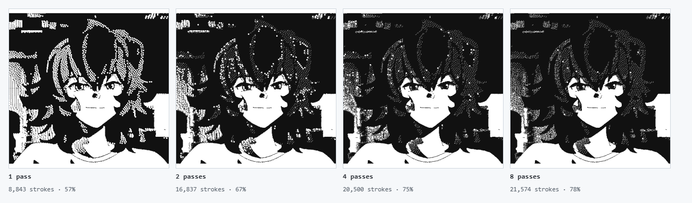

# HeyTea sticker drawer

Turn any picture into a drawing for the HeyTea app's custom sticker canvas, then let the phone draw it by itself over ADB.

**Try it:** [ncgg.dev/sticker](https://ncgg.dev/sticker/) · runs entirely in the browser, the image never leaves your device.

There are two ways to use it, both running the same engine with the same settings:

- **[the web UI](#web-ui)**: drop in a picture, tweak it with live previews, download the script for the phone;
- **[the command line](#command-line)**: `heytea-sticker draw photo.jpg` plans the drawing and draws it on the connected phone in one step, or `preview` writes a PNG without a phone.


## The problem

HeyTea lets you draw your own sticker, but the canvas is built for a finger, not for reproducing a picture:

- **Black ink only.** There is one colour and an eraser. Every shade of grey has to be faked with a pattern of solid ink and bare paper.
- **The smallest brush is 6 px.** On a canvas about 880 px wide, that is roughly 150 brush widths across. Anything thinner than the brush tip (an eyelid, a strand of hair, a highlight in an eye) gets filled in.
- **No import.** The only way in is drawing, so a picture has to become thousands of strokes that something else performs.

Drawing a recognisable picture inside those limits takes several tricks working together.

## How it gets around them

### 1. Plan on a grid the size of the brush

The picture is resampled onto a grid where the 6 px brush is exactly 3 cells wide (440 × 440 for an 880 px canvas). Planning at that resolution means every stroke the planner considers is one the phone can actually make: a round 6 px tip dragged along a row. The planner keeps a model of how much ink every cell holds, including the soft, partly covered edges of each round tip.

### 2. Brush and eraser in passes

One pass of a 6 px brush can only say "ink here or not". The eraser is the way to get detail back: brush strokes lay ink down, then the 8 px eraser sweeps back over the same rows and carves highlights and edges out of it. They alternate, pass after pass:

- a **brush pass** adds a stroke only where it brings the drawing closer to the picture (under-inking is weighted a little more than over-inking, so dark areas fill properly);
- an **eraser pass** removes ink only where that clearly helps, with the bar rising each pass so it settles instead of flickering;
- it stops when an eraser pass changes nothing, or at the pass limit.

Each extra pass recovers detail the brush tip buried, like strands of hair and the edges of the eyes:



### 3. Fake grey with dithering

With black ink only, mid-tones come from how densely the brush and eraser leave ink in an area. The pixel sweep aims each region's ink coverage at the picture's darkness there, so shadows become dense ink and light areas sparse marks. A strict two-tone version is available too, for a cleaner poster look.

### 4. Give every region its own range (local contrast)

A single light/dark cut-off for the whole picture fails on real images: a dark face falls entirely below it and its eyes, nose and mouth vanish into one black shape, while a pale sky goes blank. Before planning, the picture goes through **CLAHE** (contrast-limited adaptive histogram equalization): it is split into an 8 × 8 grid, each region's tones are spread over the full range, and neighbouring regions are blended so there are no seams. A clip limit stops flat areas from turning into noise. A light unsharp pass on top keeps fine detail.

### 5. Find the settings automatically

Brightness, contrast, midtones and passes interact in ways that are hard to guess, and the sweep is touchy: with too little contrast it falls off a cliff from "a bit dark" to blank paper. So the tool searches for them, drawing the picture over and over and scoring each result against the original:

- **The score** compares the drawing and the picture on a common grid in phone pixels. It uses SSIM's contrast-and-structure term (do edges and textures line up?), taken both softened by about a brush width and up close, plus overall tone. A plain grey-level match would reward speckle that averages to the right grey, so it isn't used.
- **The search** tries a grid of contrast and midtone combinations, then brightness, then fine-tunes the best few. To keep it quick it screens on the centre of the picture at full scale (the brush stays the right size), and only the finalists are drawn whole.
- **Tone balance:** finally, brightness is adjusted until the drawing uses as much ink overall as the picture is dark. It tries a couple of contrast starting points so it can't get stuck on the cliff.
- **A stroke budget** keeps drawing time sensible: every stroke costs a little, and past about 50,000 strokes (four hours on the phone) a lot.


### 6. Draw tile by tile

The whole picture is planned in one go, so the dithering is continuous, with no seams. The strokes are then put in tile order: the canvas is split into tiles drawn from the top left to the bottom right, each tile finished (brush pass, eraser pass, brush pass, …) before the next starts. On the phone you watch the picture fill in square by square rather than being redrawn over and over, and a finished tile is only ever touched by the very tip of a stroke next to it.


## Other styles

The pixel sweep is the default because it reproduces pictures best, but the planner can draw in other ways too: scanlines whose spacing follows tone, traced outlines, print-style halftone dots, and painterly strokes that follow the shapes.


## Using it

### Install

You need [Node.js](https://nodejs.org) 18.3 or newer, and for drawing on the phone, [Android SDK Platform-Tools](https://developer.android.com/tools/releases/platform-tools) (`adb`).

```bash
git clone https://github.com/samncg/heytea-sticker-drawer.git
```

```bash
cd heytea-sticker-drawer
```

```bash
npm install
```

`npm install` fetches one package, [`@napi-rs/canvas`](https://github.com/Brooooooklyn/canvas): a prebuilt 2D canvas that lets the command line load images and score drawings the same way the browser does. The web UI itself needs nothing installed.

### Get the phone ready

The same for both tools:

1. On the phone, turn on **Developer options**, **USB debugging** and **Pointer location**. Connect it by USB and accept the "Allow USB debugging?" prompt; `adb devices` should list it.
2. Open the custom sticker canvas in HeyTea. With Pointer location on, note the canvas's left and top edge and its width and height on screen, in pixels.
3. If the drawing uses the eraser (the pixel sweep does), also note where the eraser and pen buttons are, so the drawing can switch tools by itself. Without them it pauses and asks you to switch by hand.

How the pen moves:

- **swipe**: `input swipe`, works on any Android;
- **continuous**: `input motionevent`, Android 10+;
- **fast**: raw touch events through `sendevent`, which needs the touchscreen device and its range from `adb shell getevent -lp`.

### Web UI

```bash
npm start
```

Then open http://localhost:8000 (`node serve.js 8080` picks another port). There is no build step, so any static server works too, for example `python -m http.server 8000`. The page has to be served over http rather than opened as a file, because browsers won't start its Web Worker from a `file://` page.

1. **Image**: drop, paste or pick a picture. It is auto-matched straight away.
2. **Style**: change the style or any setting; the preview redraws as you go.
3. **Your phone**: enter the canvas edges and tool buttons (saved in the browser).
4. **Draw it**: download `draw.sh`, then:

   ```bash
   adb push draw.sh /sdcard/
   ```

   ```bash
   adb shell sh /sdcard/draw.sh
   ```

A tool-switch test script draws a line, erases a gap in it and draws a second line, to check the button positions before a long drawing.

### Command line

After `npm install`, run it with `node cli/heytea-sticker.js`, or put `heytea-sticker` on your PATH with `npm link` (the examples use the short name).

Plan a drawing and look at it, no phone needed. It writes `photo.sticker.png` and reports the stroke count and drawing time:

```bash
heytea-sticker preview photo.jpg
```

```text
Loaded photo.jpg · 640 × 605
Auto-matching Pixel sweep to the image (this takes a little while)…
  matched in 17.6 s: 78% match
Planned in 0.6 s.
Preview: photo.sticker.png
Pixel sweep · 78% match
21,702 strokes · 257 tool switches · about 2.6 h on the phone (21,702 commands, rough estimate)
settings: --no-match --mode pixel-sweep --brightness 3 --contrast -30 --midtones 140 --passes 10
```

Draw it on the phone. It checks for `adb` and the phone first, plans, pushes the script, waits for you to press Enter with the canvas open, then draws (Ctrl+C stops it):

```bash
heytea-sticker draw photo.jpg --canvas 100,600,880,880 --eraser-button 960,2300 --pen-button 840,2300
```

Check the tool buttons first with the tool-switch test:

```bash
heytea-sticker test --canvas 100,600,880,880 --eraser-button 960,2300 --pen-button 840,2300
```

More examples:

```bash
heytea-sticker preview photo.jpg --tiles 6 --passes 8 --local-contrast 70 -o tuned.png
```

```bash
heytea-sticker preview photo.jpg --mode halftone-dots --shape circle --fit cover
```

```bash
heytea-sticker script photo.jpg --method continuous -o draw.sh
```

```bash
heytea-sticker draw photo.jpg --no-match --brightness 3 --contrast -30 --midtones 140 --passes 10 --yes
```

| Command | What it does |
|---|---|
| `preview <image>` | plan, write a PNG of the drawing (`-o`, default `<image>.sticker.png`), report strokes and time |
| `draw <image>` | plan, then draw on the phone over ADB (`-o` also saves the PNG) |
| `script <image>` | plan, then write the ADB script (`-o`, default `draw.sh`) to run yourself |
| `test` | draw the tool-switch test on the phone |
| `devices` | list what ADB sees |

Without `--no-match`, the tone is auto-matched first, as on the web page, and any drawing setting you pass is applied on top of the match. Every run prints the settings it used as flags: add them to a later run to get the same drawing again without the search. `--json` prints the result as JSON, `--script FILE` also saves the ADB script, `-s SERIAL` picks a phone when several are connected, and `--adb PATH` (or `ADB=...`) points at an `adb` that isn't on PATH. `heytea-sticker --help` lists everything and `--list-styles` the styles.

If `adb` is missing, no phone is connected, the phone hasn't allowed the computer yet, or several phones are connected, it says so and stops before planning.

### Settings in both tools

The defaults are the web page's: pixel sweep, fit inside, an 880 × 880 canvas at (100, 600), a 6 px brush, an 8 px eraser, 4 tiles per side, local contrast 50, and auto-match for brightness, contrast, midtones and passes.

| Web UI | Command line | Range |
|---|---|---|
| Style | `--mode` | `pixel-sweep`, `scanlines`, `halftone-dots`, … (`--list-styles`) |
| Image fit | `--fit` | `contain` (fit inside) or `cover` (fill the canvas) |
| Sticker shape | `--shape` | `rect` or `circle` |
| Brightness | `--brightness` | -100 to 100 |
| Contrast | `--contrast` | -100 to 100 |
| Midtones | `--midtones` | 40 to 250 |
| Local contrast | `--local-contrast` | 0 to 100 |
| Darkness cutoff | `--cutoff` | 20 to 235 |
| Passes | `--passes` | 0 to 30 (0 runs until it stops helping) |
| Tiles per side | `--tiles` | 1 to 12 |
| Smoothing, Invert | `--smoothing`, `--invert` | 0 to 4, on/off |
| any other control | `--set KEY=VALUE` | engine names, e.g. `--set sen=70` for edge sensitivity |
| Brush size, Eraser size | `--brush`, `--eraser` | px on the phone |
| Left, Top, Width, Height | `--canvas L,T,W,H` | px on the phone |
| How the pen moves | `--method` | `swipe`, `continuous` or `fast` |
| Swipe time | `--swipe-ms` | ms |
| Eraser X/Y, Pen X/Y | `--eraser-button X,Y`, `--pen-button X,Y` | px on the phone |
| Extra taps after eraser/pen | `--eraser-taps`, `--pen-taps` | `"x,y; x,y"` |
| Wait after switching, Button press | `--switch-wait`, `--press-ms` | s, ms |
| Fast mode fields | `--touch-device`, `--touch-max X,Y`, `--screen W,H`, `--combine-events` | from `getevent -lp` |

### One engine

Both tools load the same `engine.js`: the command line `require`s it, the page and its Web Worker load it as a script. Image adjustment, stroke planning, the score, auto-match and the ADB script all come from that one file, so the same settings mean the same thing in both, and the same image pixels give exactly the same strokes.

The one difference is how the picture is decoded. The command line reads it like the page's main thread does, but the page's worker gets it through `createImageBitmap`, which on some JPEGs shifts the tones by a fraction of a percent. With the same settings that changes a handful of strokes (17,753 on the web against 17,786 on the command line for the sample). It is also enough for auto-match to settle on a neighbouring optimum (midtones 170 on the web, 140 on the command line, both about 78 to 79%). To carry a drawing over from the page, copy its settings into the command line with `--no-match`.

| File | What it does |
|---|---|
| `engine.js` | image adjustment, every stroke planner, the score, auto-match and the ADB script writer |
| `index.html`, `sticker.css` | the web page |
| `app.js` | controls, preview, saved phone settings, script download |
| `worker.js` | runs planning and auto-match off the page's main thread |
| `serve.js` | the local web server behind `npm start` |
| `cli/heytea-sticker.js` | the command line: arguments, image loading, PNG preview, ADB |

Part of [ncgg.dev](https://ncgg.dev).
