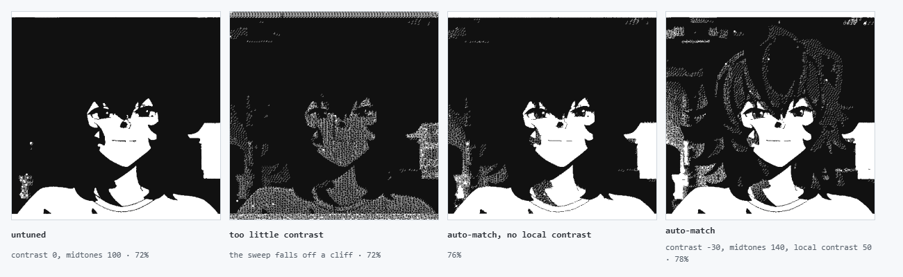

# HeyTea sticker drawer

Turn any picture into a drawing for the HeyTea app's custom sticker canvas, then let the phone draw it by itself over ADB.

**Try it:** [ncgg.dev/sticker](https://ncgg.dev/sticker/) · runs entirely in the browser, the image never leaves your device.


## The problem

HeyTea lets you draw your own sticker, but the canvas is built for a finger, not for reproducing a picture:

- **Black ink only.** There is one colour and an eraser. Every shade of grey has to be faked with a pattern of solid ink and bare paper.
- **The smallest brush is 6 px.** On a canvas about 880 px wide, that is roughly 150 brush widths across. Anything thinner than the brush tip (an eyelid, a strand of hair, a highlight in an eye) gets filled in.
- **No import.** The only way in is drawing, so a picture has to become thousands of strokes that something else performs.

Drawing a recognisable picture inside those limits takes several tricks working together.

## How it gets around them

### 1. Plan on a grid the size of the brush

The picture is resampled onto a grid where the 6 px brush is exactly 3 cells wide (440 × 440 for an 880 px canvas). Planning at that resolution means every stroke the planner considers is one the phone can actually make: a round 6 px tip dragged along a row. The planner keeps a model of how much ink every cell holds, including the soft, partly covered edges of each round tip.

### 2. Brush and eraser in passes

One pass of a 6 px brush can only say "ink here or not". The eraser is the way to get detail back: brush strokes lay ink down, then the 8 px eraser sweeps back over the same rows and carves highlights and edges out of it. They alternate, pass after pass:

- a **brush pass** adds a stroke only where it brings the drawing closer to the picture (under-inking is weighted a little more than over-inking, so dark areas fill properly);
- an **eraser pass** removes ink only where that clearly helps, with the bar rising each pass so it settles instead of flickering;
- it stops when an eraser pass changes nothing, or at the pass limit.

Each extra pass recovers detail the brush tip buried, like strands of hair and the edges of the eyes:


### 3. Fake grey with dithering

With black ink only, mid-tones come from how densely the brush and eraser leave ink in an area. The pixel sweep aims each region's ink coverage at the picture's darkness there, so shadows become dense ink and light areas sparse marks. A strict two-tone version is available too, for a cleaner poster look.

### 4. Give every region its own range (local contrast)

A single light/dark cut-off for the whole picture fails on real images: a dark face falls entirely below it and its eyes, nose and mouth vanish into one black shape, while a pale sky goes blank. Before planning, the picture goes through **CLAHE** (contrast-limited adaptive histogram equalization): it is split into an 8 × 8 grid, each region's tones are spread over the full range, and neighbouring regions are blended so there are no seams. A clip limit stops flat areas from turning into noise. A light unsharp pass on top keeps fine detail.

### 5. Find the settings automatically

Brightness, contrast, midtones and passes interact in ways that are hard to guess, and the sweep is touchy: with too little contrast it falls off a cliff from "a bit dark" to blank paper. So the tool searches for them, drawing the picture over and over and scoring each result against the original:

- **The score** compares the drawing and the picture on a common grid in phone pixels. It uses SSIM's contrast-and-structure term (do edges and textures line up?), taken both softened by about a brush width and up close, plus overall tone. A plain grey-level match would reward speckle that averages to the right grey, so it isn't used.
- **The search** tries a grid of contrast and midtone combinations, then brightness, then fine-tunes the best few. To keep it quick it screens on the centre of the picture at full scale (the brush stays the right size), and only the finalists are drawn whole.
- **Tone balance:** finally, brightness is adjusted until the drawing uses as much ink overall as the picture is dark. It tries a couple of contrast starting points so it can't get stuck on the cliff.
- **A stroke budget** keeps drawing time sensible: every stroke costs a little, and past about 50,000 strokes (four hours on the phone) a lot.



### 6. Draw tile by tile

The whole picture is planned in one go, so the dithering is continuous, with no seams. The strokes are then put in tile order: the canvas is split into tiles drawn from the top left to the bottom right, each tile finished (brush pass, eraser pass, brush pass, …) before the next starts. On the phone you watch the picture fill in square by square rather than being redrawn over and over, and a finished tile is only ever touched by the very tip of a stroke next to it.


## Other styles

The pixel sweep is the default because it reproduces pictures best, but the planner can draw in other ways too: scanlines whose spacing follows tone, traced outlines, print-style halftone dots, and painterly strokes that follow the shapes.


## Drawing it on the phone

The page writes a shell script that replays the strokes with ADB:

1. On the phone, turn on Developer options, USB debugging and Pointer location. Open the custom sticker canvas and note its edges on screen.
2. Enter those in step 03. If the drawing uses the eraser, also enter where the eraser and pen buttons are, so the script can switch tools by itself.
3. Download `draw.sh`, then:

   ```bash
   adb push draw.sh /sdcard/
   ```

   ```bash
   adb shell sh /sdcard/draw.sh
   ```

Three ways to move the pen:

- **swipes**: `input swipe`, works on any Android;
- **continuous**: `input motionevent`, Android 10+;
- **fast**: raw touch events through `sendevent`, which needs the touchscreen device and its range from `adb shell getevent -lp`.

A tool-switch test script draws a line, erases a gap in it and draws a second line, to check the button positions before a long drawing.

## Running it

There is no build step. Serve the folder and open it (the planner runs in a Web Worker, which browsers won't start from a `file://` page):

```bash
python -m http.server 8000
```

Then open http://localhost:8000.

| File | What it does |
|---|---|
| `index.html`, `sticker.css` | the page |
| `app.js` | controls, preview, saved phone settings, script download |
| `engine.js` | image adjustment, every stroke planner, the score, auto-match and the ADB script writer |
| `worker.js` | runs planning and auto-match off the main thread |

Part of [ncgg.dev](https://ncgg.dev).
