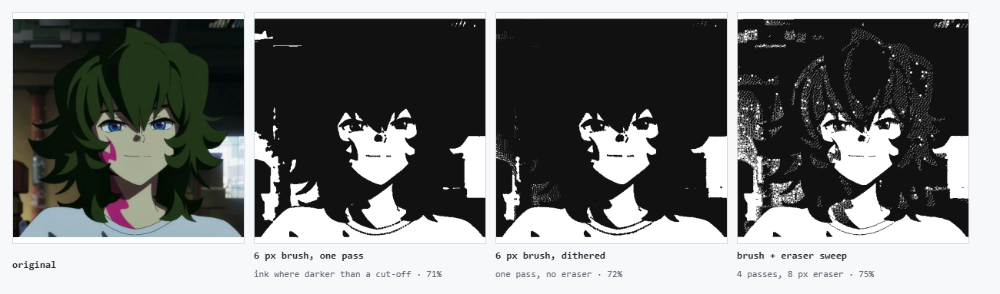
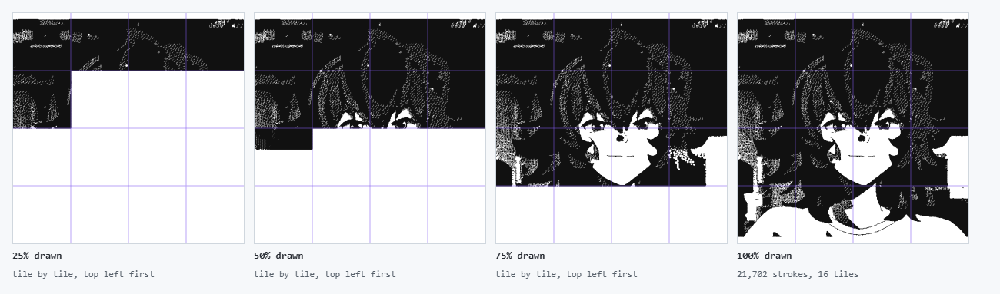
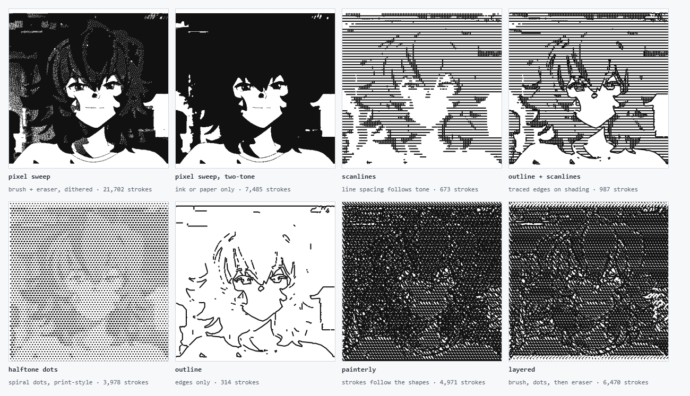

# HeyTea sticker drawer

Turn any picture into a drawing for the HeyTea app's custom sticker canvas, then let the phone draw it by itself over ADB.

**Try it:** [ncgg.dev/sticker](https://ncgg.dev/sticker/) · runs entirely in the browser, the image never leaves your device.

There are two ways to use it, both running the same engine with the same settings:

- **[the web UI](#web-ui)**: drop in a picture, tweak it with live previews, download the script for the phone;
- **[the command line](#command-line)**: `heytea-sticker draw photo.jpg` plans the drawing and draws it on the connected phone in one step, or `preview` writes a PNG without a phone.



## The problem

HeyTea lets you draw your own sticker, but the canvas is built for a finger, not for reproducing a picture:

- **Black ink only.** There is one colour and an eraser. Every shade of grey has to be faked with a pattern of solid ink and bare paper.
- **The smallest brush is about 3 dp wide.** On a 1440 × 3200 phone (560 dpi) that is 10.5 px on a canvas 1015 px wide, so roughly 95 brush widths across, and the eraser is the same size. Anything thinner than the brush tip (an eyelid, a strand of hair, a highlight in an eye) gets filled in. The figures below were drawn with a 6 px brush on an 880 px canvas; the ideas are the same at any size.
- **No import.** The only way in is drawing, so a picture has to become thousands of strokes that something else performs.

Drawing a recognisable picture inside those limits takes several tricks working together.

## How it gets around them

### 1. Plan on a grid the size of the brush

The picture is resampled onto a grid where the brush is exactly 3 cells wide (440 × 440 for a 6 px brush on an 880 px canvas, 290 × 408 for a 10.5 px brush on a 1015 × 1428 canvas; past 600 cells on the long side both sides shrink together, so the cells stay square on a tall canvas). Planning at that resolution means every stroke the planner considers is one the phone can actually make: a round tip of the brush's real width dragged along a row. The planner keeps a model of how much ink every cell holds, including the soft, partly covered edges of each round tip.

### 2. Brush and eraser in passes

One pass of the brush can only say "ink here or not". The eraser is the way to get detail back: brush strokes lay ink down, then the eraser sweeps back over the same rows and carves highlights and edges out of it. They alternate, pass after pass:

- a **brush pass** adds a stroke only where it brings the drawing closer to the picture (under-inking is weighted a little more than over-inking, so dark areas fill properly);
- an **eraser pass** removes ink only where that clearly helps, with the bar rising each pass so it settles instead of flickering;
- it stops when an eraser pass changes nothing, or at the pass limit.

Each extra pass recovers detail the brush tip buried, like strands of hair and the edges of the eyes:


### 3. Fake grey with dithering

With black ink only, mid-tones come from how densely the brush and eraser leave ink in an area. The pixel sweep aims each region's ink coverage at the picture's darkness there, so shadows become dense ink and light areas sparse marks. A strict two-tone version is available too, for a cleaner poster look.

### 4. Give every region its own range (local contrast)

A single light/dark cut-off for the whole picture fails on real images: a dark face falls entirely below it and its eyes, nose and mouth vanish into one black shape, while a pale sky goes blank. Before planning, the picture goes through **CLAHE** (contrast-limited adaptive histogram equalization): it is split into an 8 × 8 grid, each region's tones are spread over the full range, and neighbouring regions are blended so there are no seams. A clip limit stops flat areas from turning into noise. A light unsharp pass on top keeps fine detail.

### 5. Find the settings automatically

Brightness, contrast, midtones and passes interact in ways that are hard to guess, and the sweep is touchy: with too little contrast it falls off a cliff from "a bit dark" to blank paper. So the tool searches for them, drawing the picture over and over and scoring each result against the original:

- **The score** compares the drawing and the picture on a common grid in phone pixels. It uses SSIM's contrast-and-structure term (do edges and textures line up?), taken both softened by about a brush width and up close, plus overall tone. A plain grey-level match would reward speckle that averages to the right grey, so it isn't used.
- **The search** tries a grid of contrast and midtone combinations, then brightness, then fine-tunes the best few. To keep it quick it screens on the centre of the picture at full scale (the brush stays the right size), and only the finalists are drawn whole.
- **Tone balance:** finally, brightness is adjusted until the drawing uses as much ink overall as the picture is dark. It tries a couple of contrast starting points so it can't get stuck on the cliff.
- **A stroke budget** keeps drawing time sensible: every stroke costs a little, and past about 50,000 strokes (four hours on the phone) a lot.


### 6. Draw tile by tile

The whole picture is planned in one go, so the dithering is continuous, with no seams. The strokes are then put in tile order: the canvas is split into tiles drawn from the top left to the bottom right, each tile finished (brush pass, eraser pass, brush pass, …) before the next starts. On the phone you watch the picture fill in square by square rather than being redrawn over and over, and a finished tile is only ever touched by the very tip of a stroke next to it.



## Other styles

The pixel sweep is the default because it reproduces pictures best, but the planner can draw in other ways too: scanlines whose spacing follows tone, traced outlines, print-style halftone dots, and painterly strokes that follow the shapes.



## Using it

### Install

You need [Node.js](https://nodejs.org) 18.3 or newer, and for drawing on the phone, [Android SDK Platform-Tools](https://developer.android.com/tools/releases/platform-tools) (`adb`).

```bash
git clone https://github.com/samncg/heytea-sticker-drawer.git
```

```bash
cd heytea-sticker-drawer
```

```bash
npm install
```

`npm install` fetches one package, [`@napi-rs/canvas`](https://github.com/Brooooooklyn/canvas): a prebuilt 2D canvas that lets the command line load images and score drawings the same way the browser does. The web UI itself needs nothing installed.

### Get the phone ready

The same for both tools:

1. On the phone, turn on **Developer options**, **USB debugging** and **Pointer location**. Connect it by USB and accept the "Allow USB debugging?" prompt; `adb devices` should list it.
2. Open the custom sticker canvas in HeyTea. Both tools can [find it on a screenshot](#lining-up-the-canvas); otherwise, with Pointer location on, note the canvas's left and top edge and its width and height on screen, in pixels.
3. If the drawing uses the eraser (the pixel sweep does), the script needs the eraser and pen buttons too, so it can switch tools by itself. The same screenshot gives them; otherwise note where they are. Without them it stops at every switch and waits for you to tap the tool.

How the pen moves:

- **continuous** (default): `input motionevent`, Android 10+, aimed so lines come out exact (below);
- **swipe**: `input swipe`, any Android, each line drawn there and back;
- **fast**: raw touch events through `sendevent`, which needs the touchscreen device and its range from `adb shell getevent -lp`. Many phones refuse it without root.

HeyTea doesn't draw touches the way they are sent, so the script works around two things, both measured on a phone:

- **The pen trails the finger.** HeyTea smooths every stroke: for each touch event it reads, the pen moves halfway from where it is towards the finger, and lifting the finger doesn't move it any further. A press, one move and a lift draws exactly half the line. So each move is aimed at twice the step, `pen + 2 × (target − pen)`, and the pen lands exactly on the target: tested on lines, line ends at the canvas edge (the finger may overshoot past the canvas) and the eraser, all exact to the round tip. Each move is a separate `input motionevent` command, about 120 ms each, so HeyTea reads every one however full the canvas gets. Dots get the same treatment (next point).

  Swipes don't work as well. HeyTea reads a swipe about once per screen frame, and a canvas full of strokes renders slowly, so a swipe loses more of its end as the drawing grows: 253 px lines at 100 ms lost about 50 px on a fresh canvas but 189 px once 6,500 strokes were on it, and some vanished. The swipe method still draws each line there and back and never faster than 80 ms (100 by default, `--swipe-ms`), which works on a light canvas.
- **A dot needs a movement.** On a canvas full of strokes, HeyTea ignores a touch that hasn't moved by the time it reads it, so quick taps vanish. On a drawing of 36,582 strokes, 0 of 40 taps of 40 ms came out (most of the dithering in light areas and faces went missing, which left stripes), 150 and 200 ms taps came out 88 to 92% of the time, and quick 2 to 4 px swipes not at all; a press, a 2 px aimed move and a release came out 90 of 90 times. So that is how dots are drawn, which takes about three times as long as a tap: dots are most of a drawing, so it roughly doubles its time. Dots in a row that overlap anyway are drawn as one aimed line instead. The swipe method uses 150 ms taps.
- **A touch that starts outside the canvas is ignored**, even 2 px outside. The planner lets strokes at the edges reach a little past the canvas so the edge is fully inked, and those strokes vanished, leaving white bands along the edges. Every point is kept at least 3 px inside the canvas; the round brush tip still reaches the edge. The margin matters: with a canvas entered 2 px too big, one drawing pressed down just outside it 423 times, and HeyTea answered with a stray erased line from the corner of the canvas right across the picture.

Each script also picks the Brush before its first stroke: a run that starts with the eraser selected would erase its first tile instead of drawing it.

While it draws, the script keeps one line up to date in the terminal:

```text
  HeyTea sticker drawer  29,712 strokes · about 1h 48m

  ██████████▏░░░░░░░░░░░░░    42%   31m 05s left   ◌ eraser   12,480 / 29,712
```

Progress is weighted by how long each command takes, so it moves evenly. Time left starts from the plan's estimate, and after the first 20 seconds comes from the drawing's own pace, so it follows the phone when it slows down on a full canvas. At the end it prints how long the drawing took. The bar is in colour; `adb shell "NO_COLOR=1 sh /sdcard/draw.sh"` leaves the colours out.

A long drawing also looks after itself:

- **The screen stays on** while it draws (Android's "stay on while plugged in"), and the setting goes back to what it was when the drawing ends or is stopped.
- **It pauses when HeyTea leaves the screen**, for a call, the notification shade or another app, so no strokes land elsewhere. It carries on by itself, picking the right tool again, once the sticker canvas is back; time spent paused doesn't count towards the time left.
- **It can be resumed.** Every half percent or so, between strokes, it saves how far it got and which tool it was using. After stopping it (Ctrl+C, a dropped cable), `adb shell sh /sdcard/draw.sh resume` or `heytea-sticker resume` carries on from there. The saved place belongs to that one script, so a new drawing starts from the beginning.
- **The phone vibrates** when it is done, and the command line beeps.

To check a phone, `heytea-sticker test` draws a line, erases a gap and draws another.

### Lining up the canvas

The drawing has to land exactly on the canvas, and the script has to tap the Brush and Eraser buttons, so the tools need both positions on screen. Instead of reading them off with Pointer location, let them find them: open Create Sticker with the canvas empty, **pick the Brush** so its tool panel opens, and give them a screenshot.

Getting the brush width right matters as much: the plan is made for marks of exactly that width. Planned for 6 px but drawn 10.5 px wide, every mark nearly doubles, the dithering runs together into solid black and the eraser leaves big dots instead of detail, in a drawing with more than twice the strokes it needs.

Picking the Brush matters: when HeyTea's tool panel opens, the canvas moves up (on a 1440 × 3200 phone from y 656 to y 509), so a screenshot without the panel would put the drawing 147 px too low. Without the panel there are no buttons to find either, so `draw` and `test` stop and ask you to pick the Brush, and the web page says so.

- **Command line:** `draw` and `test` do this by themselves. After you press Enter they take a screenshot over ADB (`adb exec-out screencap -p`), find the canvas and the tool buttons, read the screen density for the brush width, and plan for both. `heytea-sticker detect` just reports them, and `-o screen.png` saves the screenshot with them outlined, to check.
- **Web UI:** in step 03, choose or drop a screenshot on "find it from a screenshot" (for example from `adb exec-out screencap -p > screen.png`, or the phone's own screenshot). It fills in Left, Top, Width and Height, the brush and eraser sizes and the eraser and pen buttons, and shows what it found. If a drawing needs the eraser and the buttons aren't set, step 04 warns before you download the script.

The canvas is found as an area of one flat colour (in HeyTea, light grey inside a white card): for each colour that covers a fair part of the screen, the rows and then the columns holding a good share of it give a rectangle with exact edges. The winner must be mostly that colour just inside its edges, something else just outside, and clear of the screen edges, which rules out the page, banners and toolbars. The buttons are found in the tool panel below the canvas: the selected tool sits in a light grey pill, and the items in that row are, left to right, Brush, Eraser and a tick. Strokes already on the canvas count with it, so a canvas with a drawing on it is still found. On a 1440 × 3200 phone, HeyTea's canvas is portrait, 1015 × 1428 at (213, 656), not the 880 × 880 square the settings start with, and the drawing is planned for that shape.

### Web UI

```bash
npm start
```

Then open http://localhost:8000 (`node serve.js 8080` picks another port). There is no build step, so any static server works too, for example `python -m http.server 8000`. The page has to be served over http rather than opened as a file, because browsers won't start its Web Worker from a `file://` page.

1. **Image**: drop, paste or pick a picture, and choose whether it fills the canvas (the default) or fits inside it. Brightness and contrast sliders sit right below, the same settings as the ones under Tone, for a quick adjustment. It is auto-matched straight away, and you can watch the search: twice a second the drawing pane redraws with the settings it is trying, named underneath with their stroke count, next to the best score so far, until the final match replaces it.
2. **Style**: change the style or any setting; the preview redraws as you go.
3. **Your phone**: drop a screenshot to find the canvas, or enter its edges, plus the tool buttons (saved in the browser).
4. **Draw it**: download `draw.sh`, then:

   ```bash
   adb push draw.sh /sdcard/
   ```

   ```bash
   adb shell sh /sdcard/draw.sh
   ```

A tool-switch test script draws a line, erases a gap in it and draws a second line, to check the button positions before a long drawing.

### Command line

After `npm install`, run it with `node cli/heytea-sticker.js`, or put `heytea-sticker` on your PATH with `npm link` (the examples use the short name).

Plan a drawing and look at it, no phone needed. It writes `photo.sticker.png` and reports the stroke count and drawing time:

```bash
heytea-sticker preview photo.jpg
```

```text
Loaded photo.jpg · 640 × 605
Auto-matching Pixel sweep to the image (this takes a little while)…
  matched in 13.3 s: 79% match
Planned in 0.6 s.
Preview: photo.sticker.png
Pixel sweep · 79% match
13,459 strokes · 199 tool switches · about 1.7 h on the phone (13,459 commands, rough estimate)
settings: --no-match --mode pixel-sweep --contrast -30 --midtones 140 --passes 7
```

Draw it on the phone. It checks for `adb` and the phone first, waits for you to press Enter with the canvas open, finds the canvas on a screenshot, plans for it, pushes the script and draws, with a progress bar and the time left (Ctrl+C stops it):

```bash
heytea-sticker draw photo.jpg
```

Check the tool buttons first with the tool-switch test:

```bash
heytea-sticker test
```

More examples:

```bash
heytea-sticker preview photo.jpg --tiles 6 --passes 8 --local-contrast 70 -o tuned.png
```

```bash
heytea-sticker preview photo.jpg --mode halftone-dots --shape circle --fit contain
```

```bash
heytea-sticker script photo.jpg --method continuous -o draw.sh
```

```bash
heytea-sticker draw photo.jpg --no-match --contrast -30 --midtones 140 --passes 7 --yes
```

| Command | What it does |
|---|---|
| `preview <image>` | plan, write a PNG of the drawing (`-o`, default `<image>.sticker.png`), report strokes and time |
| `draw <image>` | plan, then draw on the phone over ADB (`-o` also saves the PNG) |
| `script <image>` | plan, then write the ADB script (`-o`, default `draw.sh`) to run yourself |
| `test` | draw the tool-switch test on the phone |
| `resume` | carry on with the last drawing from where it was stopped |
| `detect [screenshot]` | find the canvas on the phone screen, or on a screenshot (`-o` saves it outlined) |
| `devices` | list what ADB sees |

Without `--no-match`, the tone is auto-matched first, as on the web page, and any drawing setting you pass is applied on top of the match. Every run prints the settings it used as flags: add them to a later run to get the same drawing again without the search. `--json` prints the result as JSON, `--script FILE` also saves the ADB script, `-s SERIAL` picks a phone when several are connected, and `--adb PATH` (or `ADB=...`) points at an `adb` that isn't on PATH. `heytea-sticker --help` lists everything and `--list-styles` the styles.

If `adb` is missing, no phone is connected, the phone hasn't allowed the computer yet, or several phones are connected, it says so and stops before planning.

### Settings in both tools

The defaults are the web page's: pixel sweep, filling the canvas, an 880 × 880 canvas at (100, 600) unless it is found on the phone (`draw` and `test` look for it, `--canvas auto` makes the others do too), a 6 px brush and an 8 px eraser unless they are found with the canvas (then both are HeyTea's real smallest size: 3 dp, from the phone's screen density over ADB, or from the canvas width in the web UI), 4 tiles per side, local contrast 50, and auto-match for brightness, contrast, midtones and passes.

| Web UI | Command line | Range |
|---|---|---|
| Style | `--mode` | `pixel-sweep`, `scanlines`, `halftone-dots`, … (`--list-styles`) |
| Image fit | `--fit` | `cover` (fill the canvas) or `contain` (fit inside) |
| Sticker shape | `--shape` | `rect` or `circle` |
| Brightness | `--brightness` | -100 to 100 |
| Contrast | `--contrast` | -100 to 100 |
| Midtones | `--midtones` | 40 to 250 |
| Local contrast | `--local-contrast` | 0 to 100 |
| Darkness cutoff | `--cutoff` | 20 to 235 |
| Passes | `--passes` | 0 to 30 (0 runs until it stops helping) |
| Tiles per side | `--tiles` | 1 to 12 |
| Smoothing, Invert | `--smoothing`, `--invert` | 0 to 4, on/off |
| any other control | `--set KEY=VALUE` | engine names, e.g. `--set sen=70` for edge sensitivity |
| Brush size, Eraser size | `--brush`, `--eraser` | px on the phone |
| Left, Top, Width, Height | `--canvas L,T,W,H` | px on the phone |
| find it from a screenshot | `--canvas auto`, `--screenshot FILE`, `detect` | the phone's screen, or a screenshot file |
| How the pen moves | `--method` | `continuous` (default), `swipe` or `fast` |
| Line time (swipe method) | `--swipe-ms` | ms per line, at least 80 (100 by default) |
| Eraser X/Y, Pen X/Y | `--eraser-button X,Y`, `--pen-button X,Y` | px on the phone (found with the canvas when not given) |
| Extra taps after eraser/pen | `--eraser-taps`, `--pen-taps` | `"x,y; x,y"` |
| Wait after switching, Button press | `--switch-wait`, `--press-ms` | s, ms |
| Fast mode fields | `--touch-device`, `--touch-max X,Y`, `--screen W,H`, `--combine-events` | from `getevent -lp` |

### One engine

Both tools load the same `engine.js`: the command line `require`s it, the page and its Web Worker load it as a script. Image adjustment, stroke planning, the score, auto-match and the ADB script all come from that one file, so the same settings mean the same thing in both, and the same image pixels give exactly the same strokes.

The one difference is how the picture is decoded. The command line reads it like the page's main thread does, but the page's worker gets it through `createImageBitmap`, which on some JPEGs shifts the tones by a fraction of a percent. With the same settings that changes a handful of strokes (22,685 on the web against 22,613 on the command line for the sample). It is also enough for auto-match to settle on a neighbouring optimum (brightness 3 and 10 passes on the web, brightness 0 and 7 passes on the command line, both 79%). To carry a drawing over from the page, copy its settings into the command line with `--no-match`.

| File | What it does |
|---|---|
| `engine.js` | image adjustment, every stroke planner, the score, auto-match and the ADB script writer |
| `index.html`, `sticker.css` | the web page |
| `app.js` | controls, preview, saved phone settings, script download |
| `worker.js` | runs planning and auto-match off the page's main thread |
| `serve.js` | the local web server behind `npm start` |
| `cli/heytea-sticker.js` | the command line: arguments, image loading, PNG preview, ADB |

Part of [ncgg.dev](https://ncgg.dev).
